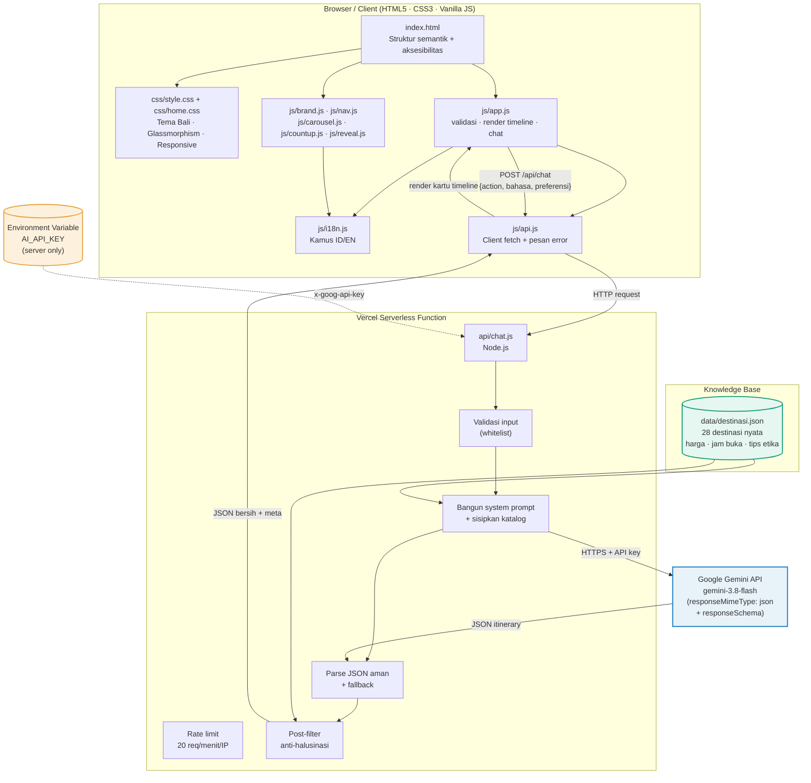
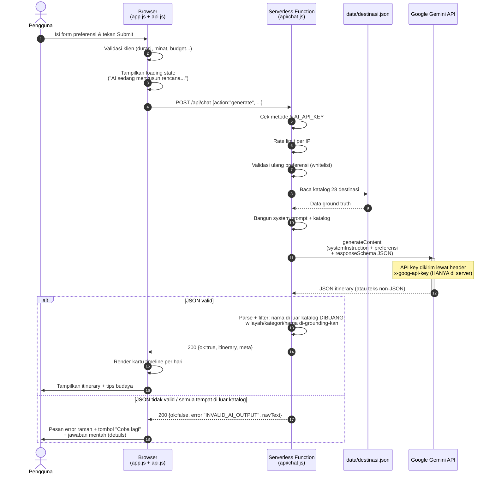
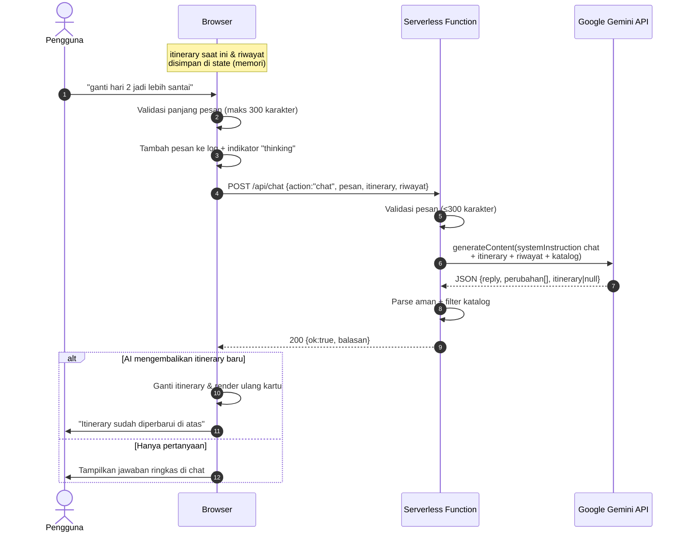
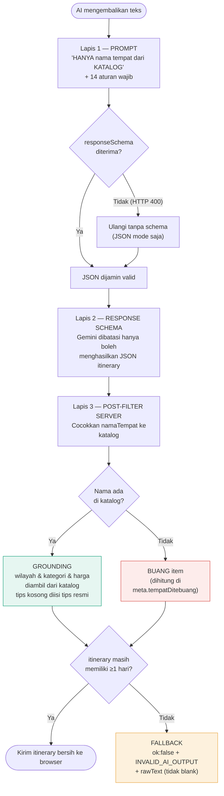
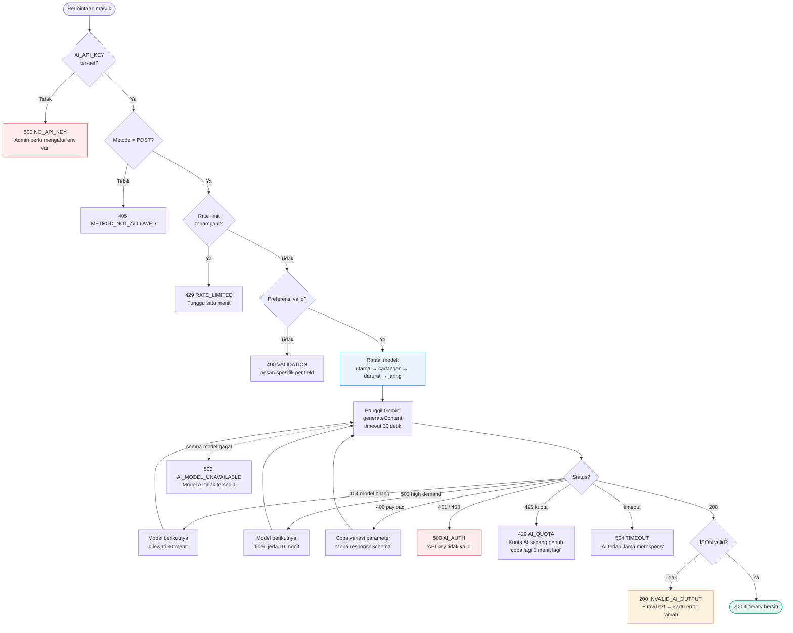
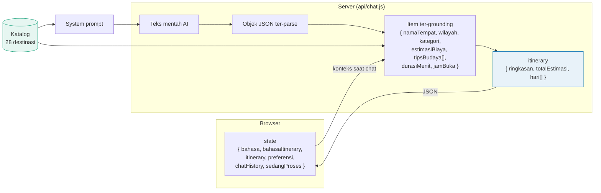

# 📐 Dokumen Perancangan Arsitektur Website

**Griska Go — Perencana Itinerary Bali Berbasis AI**
National AI Summit & Competition (NAISC) 2026 · Kategori Website

| | |
|---|---|
| **Nama Proyek** | Griska Go |
| **Tim** | [Nama Tim / Anggota] |
| **Institusi** | [Nama SMA/SMK, Kota] |
| **Tanggal** | [Tanggal] |
| **Versi Dokumen** | 1.0 |
| **Status** | Final untuk ditinjau juri |

> **Tujuan dokumen ini** menjelaskan secara teknis bagaimana Griska Go dibangun: arsitektur sistem, komponen, alur data integrasi AI, dan pertimbangan keamanannya — sehingga reviewer dapat memverifikasi bahwa solusi yang dibangun benar-benar berfungsi, bukan sekadar klaim.

---

## Daftar Isi

1. [Gambaran Sistem](#1-gambaran-sistem)
2. [Fitur Utama](#2-fitur-utama)
3. [Komponen Teknologi](#3-komponen-teknologi)
4. [Mekanisme Integrasi AI](#4-mekanisme-integrasi-ai)
5. [Diagram Alur (Mermaid)](#5-diagram-alur-mermaid)
6. [Pertimbangan Keamanan](#6-pertimbangan-keamanan)
7. [Kualitas & Pengujian](#7-kualitas--pengujian)
8. [Batasan & Rencana Pengembangan](#8-batasan--rencana-pengembangan)

---

## 1. Gambaran Sistem

### 1.1 Ringkasan

Griska Go adalah aplikasi **satu halaman (SPA)** tanpa database dan tanpa akun pengguna. Seluruh state sesi (itinerary dan riwayat chat) disimpan **di memori browser** selama halaman terbuka.

Sistem terdiri dari tiga entitas logis:

| Entitas | Peran | Isi |
|---|---|---|
| **Client** | Antarmuka pengguna | `index.html`, `css/style.css`, `css/home.css`, `js/app.js`, `js/api.js`, `js/i18n.js`, `js/brand.js`, `js/nav.js`, `js/carousel.js`, `js/countup.js`, `js/reveal.js` |
| **Serverless Function** | Gerbang ke AI,VALIDASI, orchestration | `api/chat.js` (1 fungsi Node.js) |
| **AI Service** | Otak penyusun itinerary | Google Gemini API (`gemini-3.8-flash`) |

plus satu **knowledge base** statis:

| Knowledge Base | Peran | Isi |
|---|---|---|
| `data/destinasi.json` | *Ground truth* anti-halusinasi | 28 destinasi nyata Bali + harga + jam buka + tips etika |

### 1.2 Prinsip Desain

1. **API key tidak pernah menyentuh klien.** Semua panggilan AI melewati serverless function.
2. **Grounded by construction.** AI dibatasi oleh data acuan, bukan sekadarPerformected oleh prompt.
3. **Degradasi halus (graceful degradation).** Bila JSON AI tidak valid, aplikasi tetap menampilkan sesuatu yang berguna — bukan halaman kosong.
4. **Tipis tanpa dependensi.** Nol `npm install`; proyek berjalan pada runtime Node.js bawaan.
5. **Terukur dan teruji.** 29 uji otomatis untuk logika backend + audit Lighthouse.

---

## 2. Fitur Utama

| # | Fitur | Jenis | Implementasi |
|---|---|---|---|
| F1 | Landing page (hero, masalah, cara kerja, fitur, CTA) | Presentasi | HTML semantik + CSS Grid |
| F2 | Form preferensi (durasi, budget, minat + preset + teks bebas, gaya, titik awal bebas, catatan) | Input | `<fieldset>`/`<legend>` + chip radio/checkbox + validasi ganda |
| F3 | Itinerary per hari (timeline kartu) | Output AI | JSON → DOM builder di `js/app.js` |
| F4 | Tips Budaya & Etika per lokasi | Output AI | Field `tipsBudaya`, di-*grounding*-kan ke katalog |
| F5 | Chat lanjutan yang mengingat itinerary | Interaksi | `action: "chat"` membawa `itinerary` + riwayat |
| F6 | Toggle bahasa ID / EN | Lokalisasi | Kamus i18n + `systemInstruction` bilingual |
| F7 | Loading state 3 tahap | UX | Animasi CSS + `aria-live="polite"` |
| F8 | Penanganan error ramah | UX | Kode error terstandar → pesan pengguna |
| F9 | Validasi form (client + server) | Keamanan | Whitelist di `validasiPreferensi()` |
| F10 | Pembatasan input 300 karakter | Keamanan | `maxlength` HTML + slicing server |
| F11 | Anti-halusinasi 3 lapis | Akurasi | Prompt → `responseSchema` → post-filter |
| F12 | Responsive & aksesibel | UI/UX | Mobile-first, Lighthouse A11y 100 |

---

## 3. Komponen Teknologi

### 3.1 Tabel Komponen

| Lapisan | Teknologi | Versi | Peran | Alasan pemilihan |
|---|---|---|---|---|
| **Frontend** | HTML5 | — | Struktur semantik, aksesibilitas | Native: `<fieldset>`, `<label>`, `aria-*` |
| | CSS3 | — | Layout, tema, animasi | CSS Variables, Grid, Flexbox, `clamp()`, `:has()` |
| | JavaScript (Vanilla) | ES2020 | Logika UI, render, i18n | Tanpa build step; mudah diaudit |
| **Font** | Plus Jakarta Sans (Google Fonts) | — | Tipografi | Satu font, rentang bobot 400–800, gratis |
| **Ikon** | SVG inline | — | Ikon fitur & tombol | Bebas lisensi, scalable, bisa di-style CSS |
| **Gambar** | Foto lokal (`public/images/hero/*.jpg`) | — | Foto hero carousel | Ringan, tampil saat offline saat presentasi |
| **Backend** | Node.js (Vercel Function) | ≥ 18 | Orkestrasi AI, validasi, filtering | Satu file; auto-deploy; tanpa server |
| **AI** | Google Gemini REST API | `gemini-3.8-flash` | Pembuatan itinerary | Ringan, cepat, `responseSchema` JSON mode |
| **Data** | JSON statis | 1.0 | Katalog 28 destinasi | Mudah dibaca, di-*cache* di memori server |
| **Hosting** | Vercel | — | Static + Function + Env Var | Gratis untuk pelajar, CI/CD dari GitHub |
| **Uji** | Node.js `assert` | — | 29 uji logika backend | Nol dependency, jalan di terminal |

### 3.2 Bentuk Data

**Masukan pengguna → server** (`POST /api/chat`)

```jsonc
// action: "generate"
{ "action": "generate", "bahasa": "id", "durasi": 4,
  "budget": "menengah", "minat": ["pantai","budaya"], "minatTeks": ["surfing"],
  "titikAwal": { "nama": "Canggu", "lat": -8.6478, "lng": 115.1385 },
  "gaya": "padat", "wilayahAwal": "Ubud", "catatan": "bawa keluarga" }

// action: "chat"
{ "action": "chat", "bahasa": "id", "pesan": "ganti hari 2 jadi lebih santai",
  "itinerary": { /* itinerary lengkap saat ini */ },
  "riwayat": [ { "role": "user", "text": "..." }, { "role": "assistant", "text": "..." } ] }
```

**Keluaran server → browser**

```jsonc
{ "ok": true,
  "itinerary": { "ringkasan": "...", "hari": [ /* ... */ ], "tipsUmum": { /* ... */ } },
  "budget": { "total": 7216000, "perOrang": 3608000, "perHari": 2405333,
              "kategori": { "akomodasi": 1200000, "transportasi": 1800000, "tiket": 1140000,
                            "makan": 800000, "aktivitas": 900000, "lainLain": 720000,
                            "cadangan": 656000 },
              "rincianHari": [ /* per hari, per kategori */ ],
              "status": { "kode": "dalam_budget", "batas": 8400000, "sisa": 1184000 },
              "saranHemat": [ /* ... */ ] },
  "meta": { "jumlahHari": 3, "jumlahTempat": 12, "narasiAI": true,
            "model": "gemini-3.8-flash", "bahasa": "id", "kursUSD": 16250 } }
```

---

## 4. Mekanisme Integrasi AI

### 4.1 Alur Data Lengkap (generate)

**Tahap 1 — Persiapan di browser** (`js/app.js`)

1. Pengguna mengisi form. `bacaPreferensi()` membaca seluruh field dari DOM.
2. `validasiPreferensi()` memeriksa: durasi integer 1-14, budget ∈ {hemat, menengah, mewah}, minat (kategori/preset/teks bebas) minimal 1, gaya ∈ {santai, padat}, wilayah awal tidak kosong, catatan ≤ 300 karakter.
3. Tombol submit dinonaktifkan, loading state ditampilkan.

**Tahap 2 — Transportasi** (`js/api.js`)

`Griska GoApi.buatItinerary()` melakukan `fetch('/api/chat', { method:'POST', body: JSON.stringify(payload) })` dengan `AbortController` timeout 70 detik. Pesan error dipetakan ke bahasa pengguna.

**Tahap 3 — Validasi & Perencanaan di server** (`api/chat.js` + `lib/rencana.js`)

1. Cek metode HTTP (`POST`) dan `AI_API_KEY` tersedia.
2. Rate limit 20 permintaan/menit per IP.
3. Validasi ulang preferensi (`validasiPreferensiLengkap()`: durasi, budget, minat, gaya, wilayah awal, traveler, tipe turis, transport, akomodasi, budget maksimum).
4. `muatDestinasi()` membaca `data/destinasi.json` dan `muatWilayah()` membaca `data/wilayah.json` (di-*cache* di memori server).
5. **Rencana disusun oleh kode**, bukan AI:
   - `pilihDestinasi()` menilai 28 destinasi (skor minat, gaya, harga, jarak).
   - `kelompokkanHari()` mengelompokkan secara geografis (haversine + greedy nearest-neighbour, radius harian 45 km).
   - `susunJadwal()` menyusun jam mulai/selesai di dalam jam operasional tiap tempat.
   - `hitungBudget()` menghitung akomodasi, transport, tiket, makan, aktivitas, oleh-oleh, dan dana cadangan 10%.
6. Hasil kode inilah yang dikirim ke AI: **AI hanya menulis narasi untuk rencana yang sudah final**.

**Tahap 4 — Panggilan AI**

`jalankanAI()` mengirim POST ke
`https://generativelanguage.googleapis.com/v1beta/models/{model}:generateContent`
dengan header `x-goog-api-key` (API key hanya di server) dan body:

```jsonc
{
  "systemInstruction": { "parts": [ { "text": "<system prompt + katalog>" } ] },
  "contents": [ { "role": "user", "parts": [ { "text": "<preferensi>" } ] } ],
  "generationConfig": {
    "temperature": 0.45, "topP": 0.9, "maxOutputTokens": 8192,
    "responseMimeType": "application/json",
    "responseSchema": { /* JSON Schema itinerary */ }
  }
}
```

> **Fallback berlapis:** bila Gemini menolak `responseSchema` (HTTP 400), permintaan diulang **tanpa** schema, hanya `responseMimeType: application/json`. Bila tetap gagal, error dinormalisasi menjadi pesan ramah.

**Tahap 5 — Parsing & Anti-halusinasi**

1. `ambilTeksRespons()` mengekstrak teks dari `candidates[0].content.parts[]`.
2. `parseJSONAman()` mencoba 4 strategi parsing (lihat §4.4).
3. `bersihkanItinerary()` melakukan **grounding**:
   - Cocokkan `namaTempat` ke katalog (persis →_keyword contains_).
   - **Tidak cocok → dibuang** (dihitung di `meta.tempatDitebuang`).
   - `wilayah`, `kategori`, `hargaTiket`, `jamBuka` **selalu** overwritten dari katalog.
   - `tipsBudaya` kosong → diisi dari `tipsEtika` katalog.
   - `totalBiaya` & `totalEstimasi` dihitung ulang di server.

**Tahap 6 — Render di browser**

`renderItinerary()` membangun DOM (bukan `innerHTML` dari data mentah) → kartu per hari → kartu per kegiatan berisi jam, nama, kategori, wilayah, durasi, aktivitas, biaya, tips budaya, transportasi.

### 4.2 Format JSON yang Diminta ke AI

```jsonc
{
  "ringkasan": "string, 1-2 kalimat",
  "totalEstimasi": 1234567,
  "hari": [
    { "hari": 1, "tema": "string", "totalBiaya": 450000,
      "jadwal": [
        { "jam": "08.00",
          "namaTempat": "nama PERSIS dari katalog",
          "wilayah": "string",
          "kategori": "pantai|budaya|kuliner|alam|belanja",
          "aktivitas": "string",
          "durasiMenit": 90,
          "estimasiBiaya": 75000,
          "tipsBudaya": ["tip 1", "tip 2"],
          "transportasi": "string" }
      ] }
  ]
}
```

Struktur ini didefinisikan **dua kali** secara konsisten:
- sebagai **JSON Schema** (`responseSchema`) → menjamin Gemini hanya boleh mengeluarkan JSON dengan struktur ini;
- sebagai **instruksi tekstual** di system prompt →acting sebagai pengganti bila schema tidak didukung.

### 4.3 Penggunaan `data/destinasi.json`

File ini adalah **satu-satunya sumber kebenaran**. Digunakan di 4 tempat:

| Tempat | Penggunaan |
|---|---|
| `bangunSystemPrompt()` | Katalog lengkap disisipkan ke system prompt sebagai ground truth |
| `bangunChatPrompt()` | Katalog ringkas (nama, wilayah, harga, jam buka, tips) disisipkan agar chat tidak mengarang |
| `bersihkanItinerary()` | Post-filter: nama yang tidak ada di katalog dibuang; data lain di-*grounding*-kan |
| `validasiPreferensi()` | Daftar kategori & wilayah menjadi whitelist |

Struktur tiap entri katalog:

```jsonc
{
  "id": "uluwatu",
  "nama": "Pura Uluwatu",
  "namaEn": "Uluwatu Temple",
  "wilayah": "Badung",
  "kategori": "budaya",
  "hargaTiket": 50000,
  "jamBuka": "06.00 - 19.00",
  "durasiMenit": 90,
  "deskripsi": "...",
  "tipsEtika": [ "Wajib mengenakan sarong...", "..." ],
  "catatanAI": "Lokasi paling ikonik di Badung. Cocok dikombinasikan dengan Tari Kechak..."
}
```

> `catatanAI` adalah **instruksi per.destinasi** untuk model, misal: *"Butuh satu hari penuh. Fast boat berangkat sekitar jam 08.00. Jangan dijadwalkan di hari yang sama dengan kunjungan lain yang jauh."* — inilah yang membuat AI tidak menjadwalkan Nusa Penida di tengah hari yang sama dengan Kuta.

### 4.4 Strategi Parsing & Fallback

`parseJSONAman()` mencoba berurutan:

| # | Skenario | Strategi |
|---|---|---|
| 1 | JSON polos | `JSON.parse(teks)` langsung |
| 2 | JSON dalam code fence ```` ```json ```` | Buang fence → parse ulang |
| 3 | Teks tambahan mengelilingi JSON | Ambil objek terluar dengan pemindaian kurung kurawal (**string- & escape-safe**) |
| 4 | Bukan JSON | Return `null` → memicu fallback |

**Fallback** (lapis terakhir, tidak pernah aplikasi blank):
Server membalas `200 OK` dengan `{ ok: false, error: "INVALID_AI_OUTPUT", message: "...", rawText: "..." }`.
Frontend menampilkan kotak error ramah + tombol "Coba lagi" + `<details>` berisi jawaban mentah AI untuk keperluan diagnostik.

### 4.5 Chat yang Mengingat

Konteks chat dibawa secara eksplisit, bukan "& hoped-for" dari model:

```js
kirimChat(pesan, itinerary, riwayat, bahasa)
// POST { action:'chat', pesan, itinerary, riwayat, bahasa }
```

- `itinerary` = itinerary lengkap yang sedang tampil → AI tahu rencana saat ini.
- `riwayat` = 12 pesan terakhir (role `user`/`assistant`) → AI tahu apa yang sudah dibicarakan.
- Balasan chat berbentuk JSON: `{ reply, perubahan[], itinerary|null }`.
- Bila AI mengembalikan `itinerary` baru, frontend **mengganti** itinerary yang tampil dan merender ulang (bukan menambah kartu duplikat).

### 4.8 Rantai Model Gemini & Penanganan Error

#### 4.8.1 Latar belakang

`gemini-2.0-flash` — model yang dipakai versi pertama — **sudah dihapus (shut down) oleh Google**.
Permintaan ke model tersebut selalu dibalas **HTTP 404 "models/... is not found"**. Karena itu
arsitektur AI diperluas dengan **rantai model**: server mencoba beberapa model secara berurutan
dan otomatis berpindah bila satu model bermasalah.

#### 4.8.2 Urutan model

| Urutan | Sumber env | Default |
|---|---|---|
| 1 | `AI_MODEL` | `gemini-3.8-flash` |
| 2 | `AI_MODEL_FALLBACK` | `gemini-2.5-flash` |
| 3 | `AI_MODEL_DARURAT` | `gemini-3.6-flash` |
| 4–5 | Bawaan (jaring pengaman) | `gemini-3.5-flash-lite`, `gemini-3.1-flash-lite` |

#### 4.8.3 Matriks keputusan

| Status | Gejala | Tindakan server |
|---|---|---|
| `404` | Model tidak ada / dihapus | Pindah model; model **dilewati 30 menit** (`MODEL_MATI`) |
| `503` | *"high demand"* / overload | Pindah model; model **diberi jeda 10 menit** (`MODEL_COOLDOWN`) |
| `400` | Payload ditolak | Coba variasi parameter (tanpa `responseSchema`) |
| `401`/`403` | API key salah | Berhenti, pesan "API key tidak valid." |
| `429` | Kuota habis | Berhenti, pesan "Kuota AI sedang penuh, coba lagi 1 menit lagi." |

> Mekanisme jeda membuat percakapan berikutnya **langsung memakai model yang sehat** — waktu
> respons turun dari ~39 detik menjadi ~3 detik pada request berikutnya.

#### 4.8.4 Pengamatan (logging)

Setiap kegagalan dicatat di terminal dengan **status + pesan asli dari Google**, tanpa API key:

```
[Griska Go] Gemini gagal | model=gemini-2.5-flash | status=404 (NOT_FOUND) | pesan: This model
models/gemini-2.5-flash is no longer available to new users. ...
[Griska Go] Gemini OK | model=gemini-3.6-flash | mode=schema+temperature | maxOutputTokens=32768 | 3763ms
```


---

## 5. Diagram Alur (Mermaid)

### 5.1 Arsitektur Sistem



### 5.2 Alur Data Utama (pengguna → AI → hasil)



### 5.3 Alur Chat Lanjutan



### 5.4 Pipeline Anti-Halusinasi



### 5.5 Alur Error, Rantai Model & Fallback



### 5.6 Model Data Antarkomponen




---

## 6. Pertimbangan Keamanan

### 6.1 Protect API Key

| Ancaman | Mitigasi |
|---|---|
| API key terlihat di DevTools | Kunci hanya di `process.env.AI_API_KEY` **di server**. Browser hanya memanggil `/api/chat` milik sendiri. `js/api.js` tidak pernah mentioning kunci. |
| Kunci bocor via Git | `.gitignore` mengabaikan `.env`, `.env.local`, `*.env`. Hanya `.env.example` (tanpa nilai) yang di-commit. |
| Kunci bocor di log | Kunci tidak pernah di-`console.log`. Error yang dikembalikan ke user hanya berisi pesan generik + kode; detail teknis tetap di log server. |
| Rotasi cepat | Env var di dashboard Vercel → **Redeploy**. Rotation ≤ 1 menit. |

### 6.2 Pembatasan & Validasi Input

| Lapis | Kontrol |
|---|---|
| HTML | `maxlength="300"` pada textarea catatan & input chat |
| Client JS | `validasiPreferensi()` menolak durasi di luar 1-14, budget/gaya di luar whitelist, minat kosong, wilayah kosong, biaya "lainnya" kosong |
| Server JS | `validasiPreferensi()` mengulang validasi yang sama (**tidak mempercayai klien**) |
| Server JS | `pesan.slice(0, 300)` sebelum dikirim ke AI |
| Server JS | `catatan.slice(0, 300)` sebelum dikirim ke AI |
| Server JS | Riwayat chat dipotong ke 12 pesan terakhir → mencegah token membengkak |
| Server JS | `maxOutputTokens: 8192` → batas atas biaya token per permintaan |
| Server JS | Body HTTP dibatasi 1 MB di server dev |

### 6.3 Anti-Penyalahgunaan & Biaya

- **Rate limit** 20 permintaan/menit per IP (`cekLimiter()`).
- **Batas durasi** 7 hari → jumlah aktivitas maksimum 35 per itinerary.
- **Model murah** `gemini-3.8-flash` → biaya rendah; `AI_MODEL` dapat diubah tanpa menyentuh kode.
- **Tanpa API key di klien** → risiko penyalahgunaan tidak bisa dipindahkan ke pengguna akhir.

### 6.4 Kerentanan Web Umum

| Kerentanan | Penanganan |
|---|---|
| **XSS** | Semua output AI dirender lewat `textContent` / `createElement` — bukan `innerHTML`. Exception: ikon SVG statis yang dikodekan hard-coded. |
| **Path traversal** | Server dev menolak path di luar root proyek (`filePath.startsWith(ROOT)`). |
| **Clickjacking** | Header `X-Frame-Options: SAMEORIGIN`. |
| **MIME sniffing** | Header `X-Content-Type-Options: nosniff`. |
| **Referrer leak** | Header `Referrer-Policy: strict-origin-when-cross-origin`. |
| **Izin browser berlebih** | Header `Permissions-Policy` mematikan kamera/mikrofon/geolokasi. |
| **Prompt injection** | Input pengguna tidak pernah masuk ke `systemInstruction`; input selalu placed di `contents` (user role) dan dipangkas 300 karakter. System prompt terus reiterate aturan ground truth. |

### 6.5 Batasan yang Disadari (Jujur)

- Rate limit in-memory bersifat *best-effort* — instance serverless dapat di-restart, sehingga tidak cocok untuk produksi skala besar. Pada skala projeto ini, ini sudah memadai.
- Riwayat chat tidak disimpan permanen (tanpa database) — ini keputusan desain yang disengaja untuk menjaga privasi dan menjaga proyek tetap tanpa server basis data.
- Harga tiket di katalog bersifat indikatif. Untuk produksi, katalog sebaiknya disinkronkan dengan sumber resmi secara berkala.

---

## 7. Kualitas & Pengujian

### 7.1 Uji Otomatis (`node tools/test-api.js`)

**29 uji lulus, 0 gagal.** Cakupan:

| Kelompok | Uji |
|---|---|
| Parser JSON | JSON polos; code fence markdown; teks tambahan; non-JSON; string berisi `{}` |
| Anti-halusinasi | Tempat fiktis dibuang; grounding wilayah/kategori; tips kosong diisi katalog; total dihitung ulang; nama dirapikan ke nama resmi; itinerary kosong → `null` |
| Validasi | Durasi 1-14; durasi non-bulat; budget salah; minat kosong; gaya salah; wilayah kosong; input valid; catatan dipotong 300 |
| System prompt | Katalog lengkap ikut prompt; aturan anti-halusinasi ada; format JSON ada; versi English memakai `namaEn` |
| Handler e2e | Generate sukses; chat sukses; pesan >300 ditolak; GET ditolak; tanpa API key; fallback JSON tidak valid |

### 7.2 Audit Lighthouse

| Kategori | Skor |
|---|---|
| Accessibility | **100** |
| Best Practices | **100** |
| SEO | **100** |

Yang dilakukan: label pada semua input, `alt` pada gambar, skip-link, `aria-live` pada log chat, `aria-pressed` pada toggle bahasa, focus ring kontras, rasio kontras teks ≥ 4.5:1 (diperbaiki untuk hijau tropis & nomor langkah), urutan heading tanpa lompatan.

### 7.3 Performa

| Aspek | Nilai |
|---|---|
| Ukuran HTML | ~25 KB |
| Ukuran CSS | ~28 KB |
| Ukuran JS (gabungan) | ~45 KB |
| Dependency | **0** |
| Waktu muat | < 2 detik pada jaringan umum (font di-cache, gambar lazy-load) |
| Model AI | `gemini-3.8-flash` (respons tipikal 4–10 detik) |

---

## 8. Batasan & Rencana Pengembangan

### 8.1 Batasan Versi 1.0

| Batasan | Dampak | Mitigasi |
|---|---|---|
| Tidak ada akun pengguna | Riwayat tidak tersimpan antar perangkat | Cookie/session ID + database (rencana 2.0) |
| Tidak ada pemetaan rute | Estimasi transport belum berbasis jarak | Integrasi Google Maps Distance Matrix |
| Harga statis | bisa basi | Scheduled refresh dari sumber resmi |
| Tanpa autentikasi | Endpoint bisa disalahgunakan | Rate limit & kunci hanya server (sudah) |
| Tanpa payment | — | Tidak diperlukan untuk use case |

### 8.2 Peta Jalan

| Fase | Target | Teknologi |
|---|---|---|
| **2.0** | Simpan itinerary di akun + riwayat perjalanan | Supabase / Firebase Auth |
| **2.1** | Peta interaktif + rute harian | Leaflet + OSRM |
| **2.2** | Rekomendasi personal berdasarkan riwayat | Embedding + vector search |
| **2.3** | Mode offline ( itinerary di-cache ) | Service Worker + IndexedDB |
| **2.4** | Ekspor itinerary ke PDF / kalender | jsPDF + ICS |
| **2.5** | Ekspansi ke region's lain (Yogyakarta, Lombok) | Katalog JSON generik + kolom `region` |

---

## Lampiran A — Peta Fungsi ke File

| Fungsi | Lokasi |
|---|---|
| System prompt (generate) | `api/chat.js` → `bangunSystemPrompt()` |
| System prompt (chat) | `api/chat.js` → `bangunChatPrompt()` |
| Skema JSON | `api/chat.js` → `jadwalSchema()` |
| Pemanggilan Gemini | `api/chat.js` → `panggilGemini()` / `jalankanAI()` |
| Parsing JSON aman | `api/chat.js` → `parseJSONAman()` |
| Filter anti-halusinasi | `api/chat.js` → `bersihkanItinerary()` / `bersihkanChat()` |
| Validasi preferensi | `api/chat.js` → `validasiPreferensi()` |
| Rate limit | `api/chat.js` → `terlaluBanyak()` |
| Kamus bahasa | `js/i18n.js` → `window.BaliWiseI18n` |
| Render itinerary | `js/app.js` → `renderItinerary()` / `renderHari()` / `renderStop()` |
| Chat | `js/app.js` → `kirimPesan()` / `tambahPesan()` |
| Client HTTP | `js/api.js` → `buatItinerary()` / `kirimChat()` |
| Logo brand | `js/brand.js` → `pasangLogo()` (file: `public/logo.png`) |
| Navbar (glass + menu aktif + drawer) | `js/nav.js` → `pasangEfekScroll()` / `pasangMenuAktif()` / `pasangDrawer()` |
| Carousel hero | `js/carousel.js` → `initCarousel()` (auto-play, dots, swipe, badge tips) |
| Angka statistik | `js/countup.js` → `jalankan()` |
| Animasi scroll-reveal | `js/reveal.js` → `init()` |

## Lampiran B — Rujukan Teknis

- Google Gemini API — `generativelanguage.googleapis.com/v1beta/models/{model}:generateContent`
- Gemini `responseSchema` & `responseMimeType` (JSON mode)
- Vercel Serverless Functions (Node.js runtime) & Environment Variables
- WCAG 2.1 — Contrast (Minimum) 4.5:1; Large Text 3:1
- Lighthouse v12 — Accessibility / Best Practices / SEO
- CSS Grid, Flexbox, CSS Custom Properties, `:has()`, `clamp()`

---

<div align="center">
**Griska Go** · Dokumen Perancangan Arsitektur · NAISC 2026
</div>
